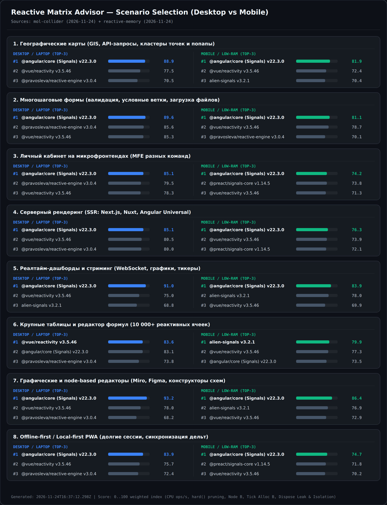

# reactive-matrix-advisor



Практический матричный анализатор для выбора реактивного движка под реальные продуктовые сценарии (для **Desktop / Laptop** и **Mobile / Low-RAM**), объединяющий замеры двух изолированных стендов:
1. **Вычислительный коллайдер:** [`mol-collider-benchmark`](https://github.com) (`2026-11-24T07:06:08.710Z`)
2. **Коллайдер памяти и GC:** [`reactive-memory-benchmark`](https://github.com) (`2026-11-24T10:00:18.914Z`)

## Матрица рекомендаций по сценариям (Топ-5)

### 1. Географические карты (GIS, API-запросы, кластеры точек и попапы)

Поток координат pan/zoom, фильтрация видимых маркеров по bbox без перерисовки неизменных точек, динамическое открытие/закрытие карточек объектов.

| Место | 💻 Desktop / Laptop (стандартный ПК) | 📱 Mobile / Low-RAM (жёсткий лимит памяти) |
| :---: | :--- | :--- |
| **#1** | **@angular/core (Signals)** `v22.3.0` (**88.9**) — `7941 ops/s`, `517.4 B/node` | **@angular/core (Signals)** `v22.3.0` (**81.9**) — `517.4 B/node`, `119.4 B/tick` |
| **#2** | **@vue/reactivity** `v3.5.46` (**77.5**) — `7964 ops/s`, `330.2 B/node` | **@vue/reactivity** `v3.5.46` (**72.4**) — `330.2 B/node`, `247.4 B/tick` |
| **#3** | **@pravosleva/reactive-engine** `v3.0.4` (**70.5**) — `8271 ops/s`, `590.7 B/node` | **alien-signals** `v3.2.1` (**70.4**) — `251 B/node`, `119.4 B/tick` |
| **#4** | **MobX** `v7.1.7` (**63.3**) — `7791 ops/s`, `522.6 B/node` | **@preact/signals-core** `v1.14.5` (**62.4**) — `257.7 B/node`, `401.2 B/tick` |
| **#5** | **alien-signals** `v3.2.1` (**61.3**) — `5466 ops/s`, `251 B/node` | **@pravosleva/reactive-engine** `v3.0.4` (**57.7**) — `590.7 B/node`, `751.5 B/tick` |

### 2. Многошаговые формы (валидация, условные ветки, загрузка файлов)

Сложные графы зависимых полей, ленивое отсечение неактивных шагов мастера, асинхронные статусы загрузки файлов и очистка при смене шага.

| Место | 💻 Desktop / Laptop (стандартный ПК) | 📱 Mobile / Low-RAM (жёсткий лимит памяти) |
| :---: | :--- | :--- |
| **#1** | **@angular/core (Signals)** `v22.3.0` (**89.6**) — `7941 ops/s`, `517.4 B/node` | **@angular/core (Signals)** `v22.3.0` (**81.1**) — `517.4 B/node`, `119.4 B/tick` |
| **#2** | **@pravosleva/reactive-engine** `v3.0.4` (**85.6**) — `8271 ops/s`, `590.7 B/node` | **@vue/reactivity** `v3.5.46` (**78.7**) — `330.2 B/node`, `247.4 B/tick` |
| **#3** | **@vue/reactivity** `v3.5.46` (**85.3**) — `7964 ops/s`, `330.2 B/node` | **@pravosleva/reactive-engine** `v3.0.4` (**70.1**) — `590.7 B/node`, `751.5 B/tick` |
| **#4** | **MobX** `v7.1.7` (**80.2**) — `7791 ops/s`, `522.6 B/node` | **@preact/signals-core** `v1.14.5` (**65.5**) — `257.7 B/node`, `401.2 B/tick` |
| **#5** | **$mol ($mol_wire_let)** `v1.0.1852` (**76.3**) — `7606 ops/s`, `532.9 B/node` | **MobX** `v7.1.7` (**65**) — `522.6 B/node`, `1544.5 B/tick` |

### 3. Личный кабинет на микрофронтендах (MFE разных команд)

Несколько независимых модулей на одной странице, строгая изоляция сторов без конфликтов глобального состояния и полное уничтожение модуля при уходе.

| Место | 💻 Desktop / Laptop (стандартный ПК) | 📱 Mobile / Low-RAM (жёсткий лимит памяти) |
| :---: | :--- | :--- |
| **#1** | **@angular/core (Signals)** `v22.3.0` (**85.1**) — `7941 ops/s`, `517.4 B/node` | **@angular/core (Signals)** `v22.3.0` (**74.2**) — `517.4 B/node`, `119.4 B/tick` |
| **#2** | **@pravosleva/reactive-engine** `v3.0.4` (**79.5**) — `8271 ops/s`, `590.7 B/node` | **@preact/signals-core** `v1.14.5` (**73.8**) — `257.7 B/node`, `401.2 B/tick` |
| **#3** | **@vue/reactivity** `v3.5.46` (**78.3**) — `7964 ops/s`, `330.2 B/node` | **@vue/reactivity** `v3.5.46` (**71.3**) — `330.2 B/node`, `247.4 B/tick` |
| **#4** | **MobX** `v7.1.7` (**70.5**) — `7791 ops/s`, `522.6 B/node` | **alien-signals** `v3.2.1` (**63.4**) — `251 B/node`, `119.4 B/tick` |
| **#5** | **$mol ($mol_wire_let)** `v1.0.1852` (**64.5**) — `7606 ops/s`, `532.9 B/node` | **@pravosleva/reactive-engine** `v3.0.4` (**61.1**) — `590.7 B/node`, `751.5 B/tick` |

### 4. Серверный рендеринг (SSR: Next.js, Nuxt, Angular Universal)

Создание изолированного графа на каждый HTTP-запрос, быстрая гидратация и гарантированное освобождение памяти после отправки HTML.

| Место | 💻 Desktop / Laptop (стандартный ПК) | 📱 Mobile / Low-RAM (жёсткий лимит памяти) |
| :---: | :--- | :--- |
| **#1** | **@angular/core (Signals)** `v22.3.0` (**85.1**) — `7941 ops/s`, `517.4 B/node` | **@angular/core (Signals)** `v22.3.0` (**76.3**) — `517.4 B/node`, `119.4 B/tick` |
| **#2** | **@vue/reactivity** `v3.5.46` (**80.5**) — `7964 ops/s`, `330.2 B/node` | **@vue/reactivity** `v3.5.46` (**73.9**) — `330.2 B/node`, `247.4 B/tick` |
| **#3** | **@pravosleva/reactive-engine** `v3.0.4` (**80**) — `8271 ops/s`, `590.7 B/node` | **@preact/signals-core** `v1.14.5` (**72.1**) — `257.7 B/node`, `401.2 B/tick` |
| **#4** | **MobX** `v7.1.7` (**72.5**) — `7791 ops/s`, `522.6 B/node` | **alien-signals** `v3.2.1` (**65**) — `251 B/node`, `119.4 B/tick` |
| **#5** | **$mol ($mol_wire_let)** `v1.0.1852` (**67.2**) — `7606 ops/s`, `532.9 B/node` | **@pravosleva/reactive-engine** `v3.0.4` (**64.3**) — `590.7 B/node`, `751.5 B/tick` |

### 5. Реалтайм-дашборды и стриминг (WebSocket, графики, тикеры)

Десятки обновлений в секунду: критично отсутствие микрофризов от Minor GC (минимальный Tick Alloc) и пакетное слияние изменений.

| Место | 💻 Desktop / Laptop (стандартный ПК) | 📱 Mobile / Low-RAM (жёсткий лимит памяти) |
| :---: | :--- | :--- |
| **#1** | **@angular/core (Signals)** `v22.3.0` (**91**) — `7941 ops/s`, `517.4 B/node` | **@angular/core (Signals)** `v22.3.0` (**83.9**) — `517.4 B/node`, `119.4 B/tick` |
| **#2** | **@vue/reactivity** `v3.5.46` (**75**) — `7964 ops/s`, `330.2 B/node` | **alien-signals** `v3.2.1` (**78**) — `251 B/node`, `119.4 B/tick` |
| **#3** | **alien-signals** `v3.2.1` (**68.8**) — `5466 ops/s`, `251 B/node` | **@vue/reactivity** `v3.5.46` (**69.9**) — `330.2 B/node`, `247.4 B/tick` |
| **#4** | **@pravosleva/reactive-engine** `v3.0.4` (**65.3**) — `8271 ops/s`, `590.7 B/node` | **@preact/signals-core** `v1.14.5` (**59.7**) — `257.7 B/node`, `401.2 B/tick` |
| **#5** | **MobX** `v7.1.7` (**58.2**) — `7791 ops/s`, `522.6 B/node` | **@pravosleva/reactive-engine** `v3.0.4` (**52.5**) — `590.7 B/node`, `751.5 B/tick` |

### 6. Крупные таблицы и редактор формул (10 000+ реактивных ячеек)

Десятки тысяч одновременно живущих узлов с перекрёстными зависимостями: решает минимальный вес узла и ленивый пересчёт только видимых ячеек.

| Место | 💻 Desktop / Laptop (стандартный ПК) | 📱 Mobile / Low-RAM (жёсткий лимит памяти) |
| :---: | :--- | :--- |
| **#1** | **@vue/reactivity** `v3.5.46` (**83.6**) — `7964 ops/s`, `330.2 B/node` | **alien-signals** `v3.2.1` (**79.9**) — `251 B/node`, `119.4 B/tick` |
| **#2** | **@angular/core (Signals)** `v22.3.0` (**83.1**) — `7941 ops/s`, `517.4 B/node` | **@vue/reactivity** `v3.5.46` (**77.3**) — `330.2 B/node`, `247.4 B/tick` |
| **#3** | **@pravosleva/reactive-engine** `v3.0.4` (**73.8**) — `8271 ops/s`, `590.7 B/node` | **@angular/core (Signals)** `v22.3.0` (**73.5**) — `517.4 B/node`, `119.4 B/tick` |
| **#4** | **MobX** `v7.1.7` (**71**) — `7791 ops/s`, `522.6 B/node` | **@preact/signals-core** `v1.14.5` (**71.8**) — `257.7 B/node`, `401.2 B/tick` |
| **#5** | **$mol ($mol_wire_let)** `v1.0.1852` (**68.9**) — `7606 ops/s`, `532.9 B/node` | **@pravosleva/reactive-engine** `v3.0.4` (**58.1**) — `590.7 B/node`, `751.5 B/tick` |

### 7. Графические и node-based редакторы (Miro, Figma, конструкторы схем)

Перетаскивание групп связанных блоков 60–120 FPS: критичен нулевой мусор при drag-and-drop (Tick Alloc) и локальный пересчёт только затронутых связей.

| Место | 💻 Desktop / Laptop (стандартный ПК) | 📱 Mobile / Low-RAM (жёсткий лимит памяти) |
| :---: | :--- | :--- |
| **#1** | **@angular/core (Signals)** `v22.3.0` (**93.2**) — `7941 ops/s`, `517.4 B/node` | **@angular/core (Signals)** `v22.3.0` (**86.4**) — `517.4 B/node`, `119.4 B/tick` |
| **#2** | **@vue/reactivity** `v3.5.46` (**78**) — `7964 ops/s`, `330.2 B/node` | **alien-signals** `v3.2.1` (**76.9**) — `251 B/node`, `119.4 B/tick` |
| **#3** | **@pravosleva/reactive-engine** `v3.0.4` (**68.2**) — `8271 ops/s`, `590.7 B/node` | **@vue/reactivity** `v3.5.46` (**72.9**) — `330.2 B/node`, `247.4 B/tick` |
| **#4** | **alien-signals** `v3.2.1` (**67.8**) — `5466 ops/s`, `251 B/node` | **@pravosleva/reactive-engine** `v3.0.4` (**55.6**) — `590.7 B/node`, `751.5 B/tick` |
| **#5** | **MobX** `v7.1.7` (**63.1**) — `7791 ops/s`, `522.6 B/node` | **@preact/signals-core** `v1.14.5` (**55.4**) — `257.7 B/node`, `401.2 B/tick` |

### 8. Offline-first / Local-first PWA (долгие сессии, синхронизация дельт)

Многочасовая работа без перезагрузки вкладки, массовое слияние пакетов синхронизации при появлении сети и строгая защита от утечек памяти (Leak).

| Место | 💻 Desktop / Laptop (стандартный ПК) | 📱 Mobile / Low-RAM (жёсткий лимит памяти) |
| :---: | :--- | :--- |
| **#1** | **@angular/core (Signals)** `v22.3.0` (**83.9**) — `7941 ops/s`, `517.4 B/node` | **@angular/core (Signals)** `v22.3.0` (**74.7**) — `517.4 B/node`, `119.4 B/tick` |
| **#2** | **@vue/reactivity** `v3.5.46` (**75.7**) — `7964 ops/s`, `330.2 B/node` | **@preact/signals-core** `v1.14.5` (**71.8**) — `257.7 B/node`, `401.2 B/tick` |
| **#3** | **@pravosleva/reactive-engine** `v3.0.4` (**72.4**) — `8271 ops/s`, `590.7 B/node` | **@vue/reactivity** `v3.5.46` (**70.2**) — `330.2 B/node`, `247.4 B/tick` |
| **#4** | **@preact/signals-core** `v1.14.5` (**64.9**) — `5389 ops/s`, `257.7 B/node` | **alien-signals** `v3.2.1` (**65.9**) — `251 B/node`, `119.4 B/tick` |
| **#5** | **MobX** `v7.1.7` (**63.1**) — `7791 ops/s`, `522.6 B/node` | **@pravosleva/reactive-engine** `v3.0.4` (**56.9**) — `590.7 B/node`, `751.5 B/tick` |


## Как обновить отчёт

```bash
cp .env.example .env
node analyze.mjs
```
